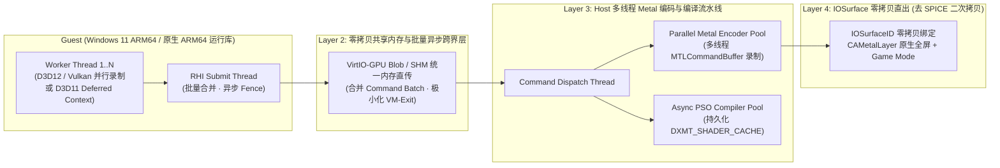

# Phase 15 架构设计：零画质妥协（1080p/4K）多线程图形管线与原生管线翻新

- **署名**：`@DNPMBHC`
- **品牌**：`Malt`
- **核心设计原则**：**拒绝以降低分辨率/画质换取帧率的妥协方案**；直面 1080p / 2K / 4K 原生高画质场景，通过**翻新落后管线、减少转译层级、打破单线程提交瓶颈**实现真正的架构级性能跃升。
- **合规红线**：100% 合法合规，零 CPUID/SMBIOS/ACPI/TPM/Hypervisor 伪装，零修改游戏/驱动二进制，零 DWM Hook/进程注入。

---

## 一、第一性原理：为什么 1080p/4K 下 GPU 仅占 33%–45%，CPU 却打满 587%？

基于 Phase 11–13 的全量真机遥测，当前图形帧路径存在 **4 处串行/落后瓶颈**：

1. **API 录制单线程卡点**：D3D11 Immediate Context 强制单线程录制，所有 DrawCall、常量缓冲更新与状态切换挤在 Guest 单条渲染线程（RHI Thread）中，再叠加 Prism `x86_64 → ARM64` 转译，单核先被打穿。
2. **跨界提交与 VM-Exit 放大**：零散的资源更新与绘制指令跨 Guest→Host 通道触发高频 VM-Exit 与序列化开销。
3. **Host 端二次显示拷贝（SPICE 遗留层）**：`QEMURenderServer` (`dxmt-native`) 已在 Apple Silicon 统一内存中完成 Metal 渲染，后续却仍绕经 `SPICE DisplayChannel → CocoaSpice CSMetalRenderer` 做二次纹理拷贝与同步（4K 下每帧多出 ~32 MiB 带宽浪费，且造成约 `2.93 ms` 帧同步 `Slack + Slop`）。
4. **老旧模拟外设中断污染**：模拟 `usb-mouse`、`intel-hda`、用户态 `slirp` 持续向 Guest vCPU 注入高频模拟中断，与游戏主渲染线程争抢 Apple Silicon P-Core。

---

## 二、四层「多线程原生图形管线」架构设计

### Layer 1：API 层多线程解耦（打破 Guest 单核提交瓶颈）
1. **原生多线程低开销 API 优先（D3D12 / Vulkan 1.3+）**：
   - **普通 1080p / 4K 游戏（零虚拟化路径）**：在 `Malt` 原生转译模式中直走 `D3DMetal`（DX12）或 `DXMT`（DX11）+ Apple 原生硬件 `MetalFX`，吃满宿主机全核与 GPU，零虚拟化损耗。
   - **容器模式多线程 API 探索**：验证并打通容器内 **WHQL 签名 `vulkan_virtio`（Vulkan 1.3+）** 与 **`NPT_CAPSET_D3D12`（D3D12 多线程 CommandList）**，将单线程 Draw-Call 录制拆散到 4–8 个 vCPU 并行执行（对具体游戏仅测试官方原生启动参数如 `-dx12` / `-vulkan`，绝不注入第三方 DLL）。
2. **D3D11 兼容路径的异步流水线压榨**：
   - 核查并启用 `D3D11_FEATURE_THREADING`（`DriverConcurrentCreates` / `DriverCommandLists`），让游戏引擎的并发资源创建与延迟上下文卸载出主线程；
   - 在宿主机 `dxmt-native` 侧充分发挥 **三级异步流水线**（API 接收线程 → 独立 Metal 编码线程 → 异步 PSO 编译线程池 + 持久化 `DXMT_SHADER_CACHE`），防止任何编译/上传操作反压阻塞 Guest 主线程。

### Layer 2：跨界传输翻新（批量提交 + 统一内存共享）
- **批量异步提交与非阻塞 Fence**：借鉴 Phase 4B M2.5 异步 Fence（`471.98 FPS` / `24.77×`）架构，将每帧的大量细碎提交合并为少量大块异步批次，大幅削减 VM-Exit 次数；
- **大资源零拷贝 SHM（Blob Resource）评估**：调研在 `UTM-Custom` + `viogpu3d` 下启用更大共享内存区（`hostmem` / `blob=true`），利用 Apple Silicon CPU/GPU 物理统一内存特性，减少 4K 高清贴图与动态粒子缓冲的多余内存拷贝。

### Layer 3：显示呈现翻新（`IOSurface` 零拷贝直出，淘汰 SPICE 二次拷贝）
- 复用 Phase 5C 已打底的 `GuestSurfaceIOSurfacePresenter` 架构思路，将 `QEMURenderServer` 产出的 `IOSurface` 直接呈现到 `Malt` / `UTM-Custom` 原生全屏 `CAMetalLayer`；
- 彻底跳过 `SPICE DisplayChannel → CSMetalRenderer` 的二次纹理拷贝与重采样，直接消除 4K 高刷下每帧 ~32 MiB 的无效显存带宽消耗，并把 `Slack + Slop (2.93 ms)` 同步损耗压向理论下限。

### Layer 4：外设全面半虚拟化 + 核簇隔离（渲染主线程零打扰）
- **外设去模拟化**：
  - 存储：`VirtIO-Blk` 多队列（`num-queues=4`）+ 独立 `iothread` + `discard=unmap`（已实证 4K 随机读 `+52.7%`、流式读 `9.2 GiB/s`）；
  - 网络：全面淘汰单线程 `slirp`，切向 macOS 原生 `vmnet.framework` 或独立高 QoS 异步网络进程（修复突发渲染期网络 P99 抖动）；
  - 输入：评估 WHQL `virtio-input` 替代模拟 `usb-mouse`，配合宿主机 1.5ms 无损合批彻底消除高频鼠标中断；
  - 音频：评估 `virtio-sound` 直通 CoreAudio 替代模拟 `intel-hda`。
- **容器内原生 ARM64 化**：系统运行库（VC++ ARM64 / .NET ARM64 / WHQL ARM64 驱动）全面原生化，配合持久化 `XtaCache` 将 Prism 转译开销压到最低。

---

## 三、待同步修复的 Phase 13 实战断路清单（一并纳入 Phase 15）

在只读代码体检中已定位 3 处 `UnifiedRuntimeOrchestrator` 实战断路，Phase 15 将一并根治：
1. **【P0】Wine 启动/安装路由修正**：将 `UnifiedRuntimeOrchestrator.swift` 中硬编码的 `/usr/bin/env wine64` 替换为 WhiskyKit 原生 `Wine.runExternal` + `BottleGraphicsRouting`（完整继承 `DXMT / D3DMetal / DXVK / WINEDLLPATH`）。
2. **【P0】容器路径自发现与资源内嵌**：消除 `graphics-lab/golden_guest_manager.py`、`kiosk-app-shell.ps1` 的相对路径硬编码，支持自动发现内置脚本、`/Applications/UTM-Custom.app` 与外置 SSD 上的持久化游玩 VM。
3. **【P1】无桌面安装器端到端透传与非阻塞测速**：`installViaAntiCheatVM` 透传 `--window-title` / `--window-size` / `--app-shell-state-file` 并将选中 `.exe` 传入 Guest `kiosk-app-shell.ps1` 自动弹出安装；将 `HardwareAutoTuner.runDiskIOBenchmark` 迁入 `Task.detached` 避免阻塞 UI。

---

## 四、产品体验与单应用内嵌架构铁律（用户 2026-11-25 拍板）

1. **彻底整合为单一软件 `Malt.app`（消灭独立 UTM 窗口与双图标割裂）**：
   - 不再把外置 `UTM.app` / `UTM-Custom.app` 作为独立软件拉起；
   - 将定制后的轻量虚拟化执行后端（`QEMU` + `dxmt-native` + `swtpm` + `IOSurface`/`Metal` 呈现器）直接内嵌至 `Malt.app/Contents/Helpers/` 与 `Frameworks/`；
   - 安装器、启动器与游戏画面全部直接渲染在 **`Malt.app` 自己的原生 macOS 窗口**中，程序坞全程只有 `Malt` 一个图标，实现真正的无感交互。
2. **开箱即用打包策略（允许合理增大包体，彻底消灭手工配置）**：
   - 放弃过度追求极小包体而拆散依赖的做法：把所有难配置的容器核心运行时、图形库、优化脚本与默认配置直接随 `Malt.dmg` 打包就绪；用户拖入 `/Applications` 双击即可使用（仅大容量系统底座镜像与游戏数据默认引导至外置高速 SSD）。
3. **前端设置重构（自动检测硬件 + 限制在安全可调范围）**：
   - 启动自动检测本机芯片、总核数与物理内存，动态生成**仅包含本机安全可调范围**的选项（防止越界配置导致卡死）；
   - **内存选择极简化**：用户只需点选 `6 GB` / `8 GB` / `10 GB` / `12 GB`（按本机总内存动态呈现并标出推荐档），**严禁要求用户手动输入 MiB 数值**；
   - **三档直观性能预设**：统一收敛为 **`最高性能`**、**`平衡`（默认推荐）**、**`低配置兼容`**；
   - **默认静默优化 + 高级选项折叠**：高回报率鼠标无损合批、macOS 游戏模式、全屏防误触（`Cmd+W/Q/H/M`）、键位映射、多队列 I/O 与持久化缓存**全部默认开启且不堆砌在主界面**，仅在折叠的「高级选项」中允许极客微调。

---

## 五、演进路线与诚实边界

- **Phase 15A（多线程图形管线与 `IOSurface` 零拷贝直出研究与落地）**：验证容器内 D3D12 / Vulkan 多线程命令录制、D3D11 异步线程特性、`IOSurface` 零拷贝直出到 `Malt` 原生窗口原型与 `virtio-input` / `virtio-sound` 替代模拟外设，并以 **1080p 与 4K 原生分辨率（零降质）** 作为硬性验收基线。
- **Phase 15B（`Malt` 单应用内嵌后端 + 极简防呆前端重构 + 一键打通实战修复）**：
  - 将虚拟化引擎内嵌至 `Malt.app`（单 App 无感渲染，告别打开外部 UTM 界面），把难配容器依赖随 `Malt.dmg` 直接打包；
  - 按上述铁律重构前端设置（硬件自检动态范围、点选 `GB` 内存、三档 `最高性能 / 平衡 / 低配置兼容`、鼠标/游戏模式/防误触默认开启并收进高级选项）；
  - 一并修通 `UnifiedRuntimeOrchestrator` 3 项实战断路 Bug 与网络代理独立高 QoS。
- **诚实物理边界**：对于尚未发布原生 Windows ARM64 客户端的 `x86_64` 游戏，Prism 转译层仍存在固定 CPU 占比；本架构的目标是将**除指令转译之外的所有图形提交、跨界拷贝、显示合成与外设中断开销全部压到原生接近零损耗**。
